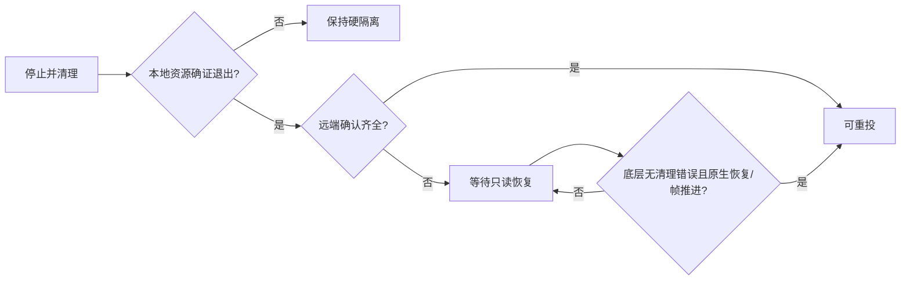

# 1.7.2 停止、换应用后重投恢复

APK code45，配套带受保护查询的仪表App。不是删除隔离开关，也不只改错误提示。

## 修复点

1.7.1仍将“采集/USB未退出”和“本地已退出、仅仪表回复缺失”混成QUARANTINED。恢复入口只处理物理断线，普通停止后的隔离无读回路径。现在以采集EXIT及资源标记、USB接口释放与线程终止分别证明本地退出；仅缺远端确认时进入RECOVERY_REQUIRED。点击开始或切模式前，在同一受控USB上查询恢复，再决定是否继续，不盲目清状态。

恢复不发送HELLO、媒体START/STOP、背景START/RESTORE/RENEW或CAN。最多等待原五秒租约的六秒观察窗口，要求受保护查询成功、背景/布局回原态、两次同代渲染帧推进；不能靠连接成功或等待时间到直接解锁。底层单次I/O有独立有限超时，六秒不是严格端到端延迟承诺。

原接收器即使持有cleanup sticky错误仍可能发送新OFFER，实际ARM反例已证实。因此本次仪表增加op0/nonce0/hold1受保护QUERY：读取而不清除原错误标志，异常返回8；老接收器拒绝这个marker，不能冒充支持。只改两个指令入口和原控制slot内已核空闲NOP，不改媒体、USB角色、原HMI/KZB、租约或MCU/OS/Boot。

另修终态先发布但Android旧Service还在finishing的重投间隙：在后台有限等待旧实例退出，不把START送进必然忽略它的实例。更换应用时先请求原会话停止，清理完再点击开始，不自动叠加新会话。保存最后一次清理原因（有界、注明历史/版本），重开进程后的日志仍可看到上次事件；它仅用于诊断，不作为恢复授权。

## 升级、操作

需要同目录APK及1.7.2仪表App才能获得完整恢复能力；仅装APK不能让旧接收器支持新查询。完整包包含未改原MCU、参考2 OS和Boot；已匹配的OS/MCU无需为了本次修复重新刷。保留原包名、签名、应用数据和ADB身份，1.7.1里程/所有布局资源完全保持。

正常投屏后点击停止，等“已停止”；再点击开始。同样测试更换应用后停止原会话、再投屏。若提示等待恢复，点击开始会做安全查询；没有通过时不会叠加START或强切Host，也不要求拔线。真正采集/USB未退出继续硬隔离；仪表明确返回底层清理错误时仍需排除真实故障，可能需要正常重启，不能承诺所有故障都无重启恢复。

## 证据边界

用户此次786字节ZIP实际APK1.4.0，新进程空闲/无停止过程；不能从中唯一认定当时哪一步失败，也不是1.7.1实车日志。上述恢复缺口和新OFFER反例由当前源码及本地指令执行确认。

单测覆盖本地证明组合、停止后待恢复、真实硬隔离、过期/活动/冻结/重启/错误能力/错误8/旧marker拒绝及只查询线路；原生测试检查marker、不写HMI/错误位、旧操作与中心选择器等价。Android独立构建、生产DEX/原签名/保存负载另核。状态应用/OS/GPU仍不是目标实车；本轮不把模拟通过写成现场已根治，也不重开历史Host/NCM成功基线。
