# 仪表投屏实现时序

本文对应 **APK 1.39.0/code96＋仪表 1.39.0/RWVI**（初版于 2026-11-06 整理）。源码以本文所在提交为准；最后单列主题几何控制、告警位置和离线验证边界。

## 阅读索引

| 图 | 要回答的问题 |
|---|---|
| [1. 端到端总览](#1-端到端总览) | 从点击开始到仪表显示，整体经过哪些环节？ |
| [2. 开机与连接](#2-开机与连接) | 两个开关恢复后，哪些动作自动发生？ |
| [3. 切换 NCM](#3-切换-ncm) | APK 如何通过原厂通道切换仪表 USB？ |
| [4. 恢复 U 盘模式](#4-恢复-u-盘模式) | 如何在线结束投屏并恢复 Host？ |
| [5. 普通应用启动](#5-普通应用启动与任务接管) | 冷启动、已有任务和更换应用如何处理？ |
| [6. 主屏显示与操作](#6-主屏显示触摸原图标与切换其他应用) | 同一任务如何在两端显示，原图标和触摸如何工作？ |
| [7. 定制地图专用入口](#7-定制地图专用入口) | 地图独立仪表页面与普通应用有何区别？ |
| [8. 按屏幕名接入](#8-按屏幕名接入) | 外部应用如何向待机屏送画面？ |
| [9. 地图原生按钮](#9-定制地图原生按钮) | 地图自带按钮如何触发我们的会话？ |
| [10. 视频共同链路](#10-编码传输与显示的共同链路) | 编码、握手、发送和首次打开背景的顺序是什么？ |
| [11. 仪表合成](#11-仪表合成与租约) | 视频、背景蒙版和原生信息怎样叠加与恢复？ |
| [12. 两档分辨率](#12-全屏与小窗的分辨率和双端输出) | 1920×720 与应用实际布局分辨率有什么区别？ |
| [13. 停止与换应用](#13-正常停止与更换应用) | 怎样归还任务，避免导航中断和资源残留？ |
| [14. 断线与隔离恢复](#14-拔线失败与自动清理) | 无法收到清理确认时如何恢复？ |
| [15. 样式切换修复](#15-整套仪表样式切换几何控制) | 样式变化时如何保持全屏几何、恢复最新主题？ |

### 参与者和通道

| 参与者/通道 | 职责 |
|---|---|
| `ProductActivity / ProductController` | 三个标签页、操作窗口、连接开关、开始/停止/换应用的协调 |
| `ProjectionService / ProjectionSessionController` | 一个前台投屏会话和清理状态；不随页面离开而停止 |
| 本机 ADB `127.0.0.1:5555` | 使用已授权身份，以 shell 身份启动本 APK 的宿主；也调用原厂导航服务、授予本 APK 的 USB 权限 |
| `ShellScreenCapture` 等宿主 | 创建/持有虚拟屏、接管或启动应用、编码、处理操作窗口和输入 |
| Binder | APP 与自己 shell 宿主之间的 Surface、输入和接入屏控制；带会话票据/调用方校验 |
| 用户态 USB NCM | APK 直接访问 USB bulk 接口，在用户态实现 Ethernet/IP/TCP；不依赖车机出现系统网卡 |
| DCV1/TCP | 车机 `192.168.77.2` → 仪表 `192.168.77.1:17475`；视频、心跳和背景控制共用有序连接 |
| `dashcast-usb` | 接收模式指令，串行切换仪表 Host/NCM，管理自己的 USB/网络进程 |
| `dashcast-receiver` | 协议接收、向原生媒体链提交 H.264、管理视频窗口、转交 HMI 请求 |
| `rc_hmi.exe / KZB / QNX Screen` | 渲染线程应用布局/蒙版和租约；视频在下，原生信息与告警在上 |

**三条通道应分开看**：USB 角色命令走原厂导航文字通道；车机到仪表的视频走 NCM 上的 DCV1/TCP；主屏操作窗口与 shell 宿主之间走 Binder。本机 ADB 视频 stdout 只把编码数据送回 APK，不是另一条跨仪表的视频线路。

## 1. 端到端总览

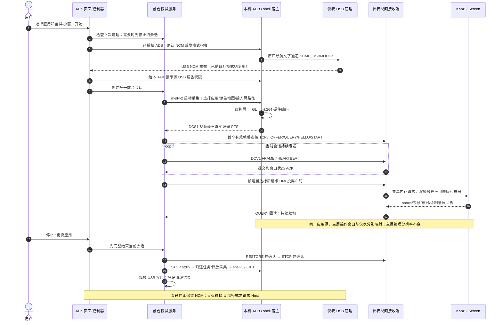

本图概括成功路径；若已存在可用 NCM，不会重复发送切换命令。首次 ADB RSA 授权仍须用户允许；“视频无激活码”不表示跳过 Android 的 ADB/USB 权限。

## 2. 开机与连接

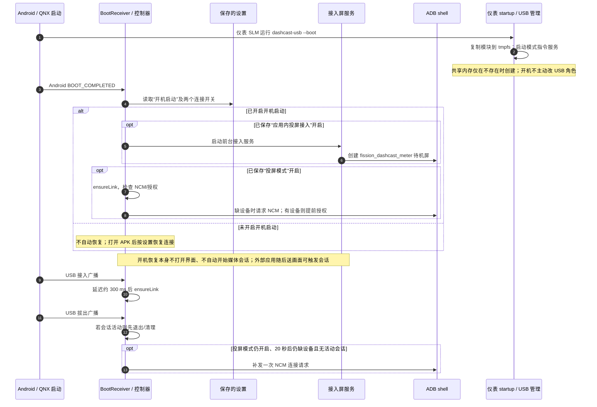

车机原厂自启动管理是否放行，会影响开机广播后的运行。1.23.0 起，连接失败保留用户选择，显示失败状态；不会因为约 16 秒没发现 NCM 就自动切 Host。

源码：[BootStart](../android/app/src/main/java/com/byd/dashcast/phase1/BootStart.kt)、[ProductController](../android/app/src/main/java/com/byd/dashcast/phase1/ProductController.kt)、[dashcast_usb.c](../instrument/native/dashcast_usb.c)。

## 3. 切换 NCM

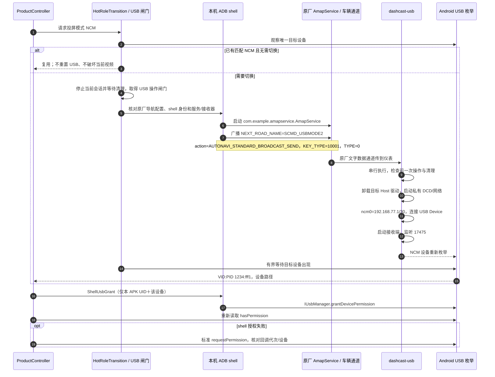

- 原厂导航功能号 `1140461576` 是框架功能号，不能当成原始 CAN 仲裁 ID。本图不虚构底层 CAN ID，也不把“广播发出”视为切换成功。
- Android 侧成功条件是观察到唯一匹配的 NCM 并获得访问权限；仪表提示和物理 Host/U 盘能力属于另一类证据。
- APK 的连接失败策略与仪表脚本内部的失败恢复不同：脚本在 NCM 后端初始化失败时可以尝试恢复自己管理的 Host。

源码：[NavigationUsbProtocol](../android/app/src/main/java/com/byd/dashcast/phase1/NavigationUsbProtocol.kt)、[NavigationUsbRelay](../android/app/src/main/java/com/byd/dashcast/phase1/NavigationUsbRelay.kt)、[HotRoleTransition](../android/app/src/main/java/com/byd/dashcast/phase1/HotRoleTransition.kt)、[ShellUsbGrant](../android/app/src/main/java/com/byd/dashcast/phase1/ShellUsbGrant.kt)、[dashcast_usb.c](../instrument/native/dashcast_usb.c)。

## 4. 恢复 U 盘模式

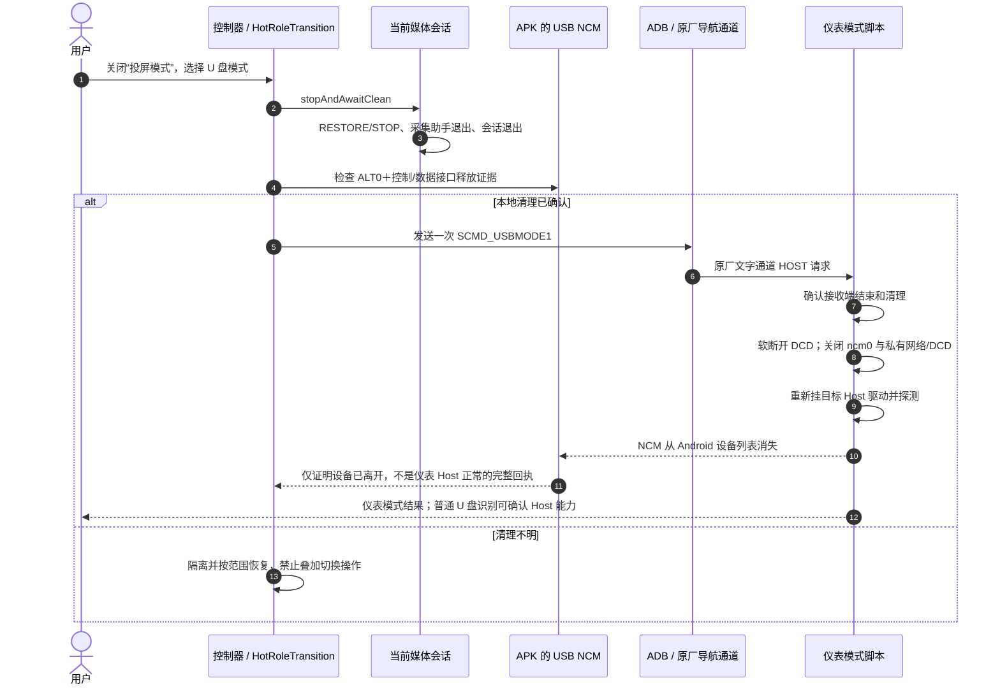

逻辑上支持保持数据线连接进行切换。关闭 TCP 不等于释放 USB 接口；基础 Host↔NCM 切换与视频失败后的恢复，要分别判断。

## 5. 普通应用启动与任务接管

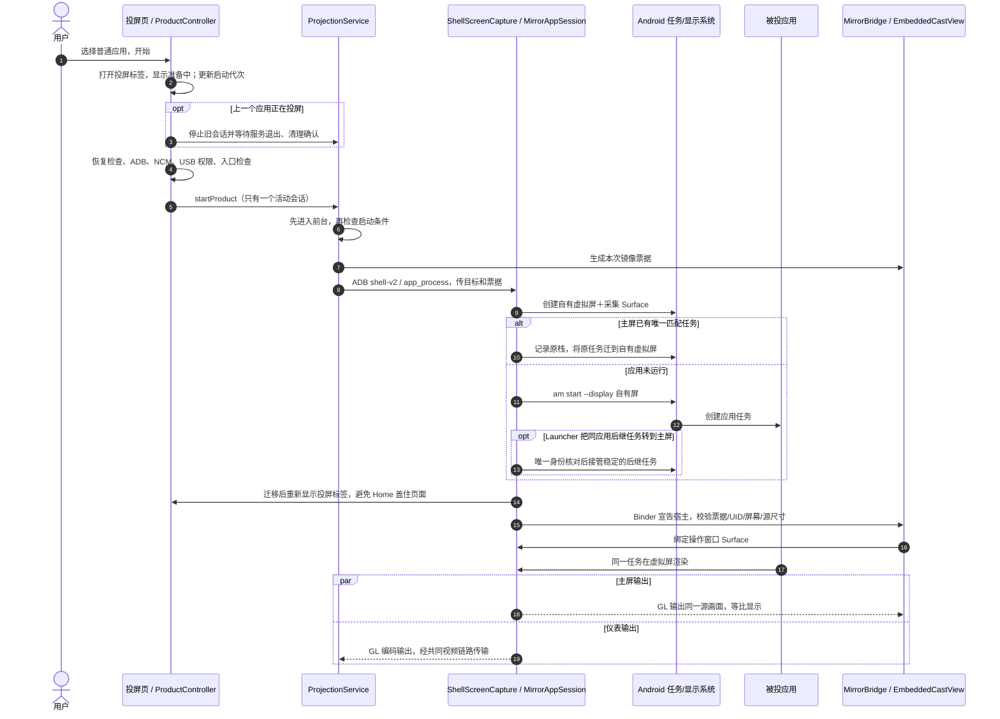

这条路径是**同一用户、同一应用任务、同一状态的两端显示**，不复制账号或应用数据。任务留在自有虚拟屏时，主屏投屏标签承载它的可操作画面。启动代次可以取消过时请求，避免较慢的旧异步操作在新选择之后又开始。

源码：[ProductController](../android/app/src/main/java/com/byd/dashcast/phase1/ProductController.kt)、[ProjectionService](../android/app/src/main/java/com/byd/dashcast/phase1/ProjectionService.kt)、[MirrorAppSession](../android/app/src/main/java/com/byd/dashcast/phase1/MirrorAppSession.kt)、[MirrorBridge](../android/app/src/main/java/com/byd/dashcast/phase1/MirrorBridge.kt)。

## 6. 主屏显示、触摸、原图标与切换其他应用

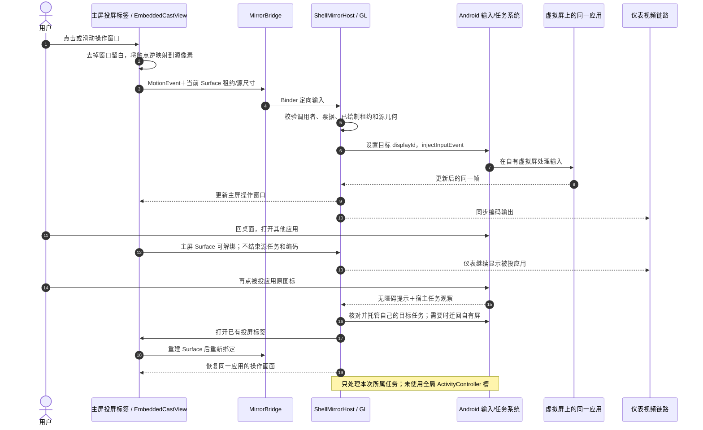

返回键也定向到所属虚拟屏。系统输入法可在车机上工作，但仍受系统及应用的多屏支持限制；投屏页使用 `ADJUST_NOTHING`，键盘不会通过挤压主屏操作窗口改变应用虚拟屏的布局。切其他应用不结束投屏，不等于保证所有第三方应用都支持副屏生命周期。

源码：[EmbeddedCastView](../android/app/src/main/java/com/byd/dashcast/phase1/EmbeddedCastView.kt)、[ShellMirrorHost](../android/app/src/main/java/com/byd/dashcast/phase1/ShellMirrorHost.kt)、[MirrorAppSession](../android/app/src/main/java/com/byd/dashcast/phase1/MirrorAppSession.kt)、[MirrorLaunchObserver](../android/app/src/main/java/com/byd/dashcast/phase1/MirrorLaunchObserver.kt)。

## 7. 定制地图专用入口

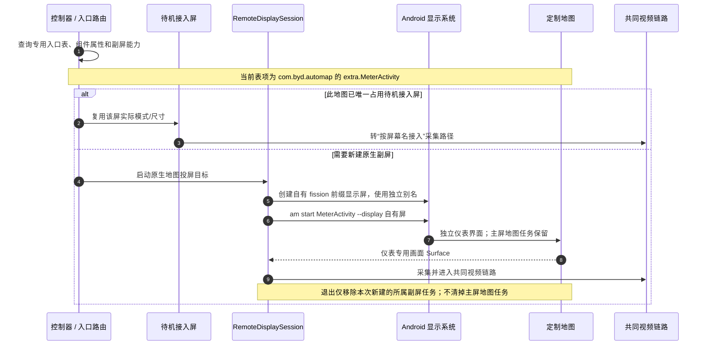

专用入口与普通应用同任务镜像是两种机制。当前表不代表所有高德版本都有原生副屏入口；没有匹配入口的应用走普通路径，或由其外部屏幕能力走接入路径。地图自身怎样共享导航状态由地图实现决定。

源码：[入口表](../android/app/src/main/assets/native_projection_entries.json)、[ProjectionEntryRouter](../android/app/src/main/java/com/byd/dashcast/phase1/ProjectionEntryRouter.kt)、[RemoteDisplaySession](../android/app/src/main/java/com/byd/dashcast/phase1/RemoteDisplaySession.kt)。

## 8. 按屏幕名接入

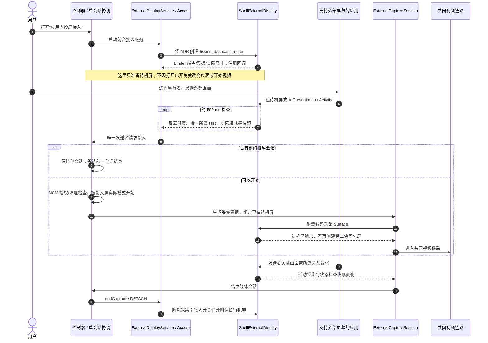

接入屏空闲时才能按全屏/小窗偏好重建尺寸；活动画面使用实际屏幕尺寸，不在应用运行中随意改屏。关闭接入开关时，现有采集可先完成，所属画面与采集都离开后再释放待机屏。

**当前边界**：接入服务还在启动、Binder 端点尚未建立时，模式请求可能没有被保存重放；高德车机版普通投屏与它主动向接入屏发画面的冲突也仍是已知项，不能把这两种情况画成全部兼容。

源码：[ExternalDisplayService](../android/app/src/main/java/com/byd/dashcast/phase1/ExternalDisplayService.kt)、[ExternalDisplayAccess](../android/app/src/main/java/com/byd/dashcast/phase1/ExternalDisplayAccess.kt)、[ShellExternalDisplay](../android/app/src/main/java/com/byd/dashcast/phase1/ShellExternalDisplay.kt)、[ExternalCaptureSession](../android/app/src/main/java/com/byd/dashcast/phase1/ExternalCaptureSession.kt)。

## 9. 定制地图原生按钮

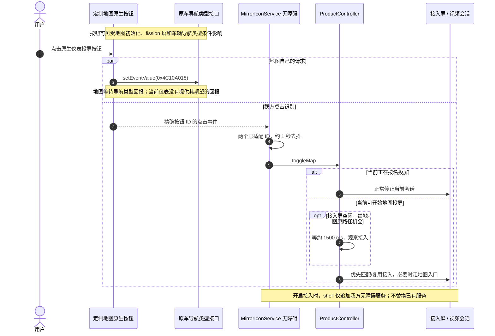

因此“显示了按钮”“识别了点击”“建立媒体会话”是三个不同环节。1.21.0 后已删除自绘悬浮按钮，当前走原按钮识别和正常会话协调。

源码：[MirrorIconService](../android/app/src/main/java/com/byd/dashcast/phase1/MirrorIconService.kt)、[ProductController](../android/app/src/main/java/com/byd/dashcast/phase1/ProductController.kt)、[ShellExternalDisplay](../android/app/src/main/java/com/byd/dashcast/phase1/ShellExternalDisplay.kt)。

## 10. 编码、传输与显示的共同链路

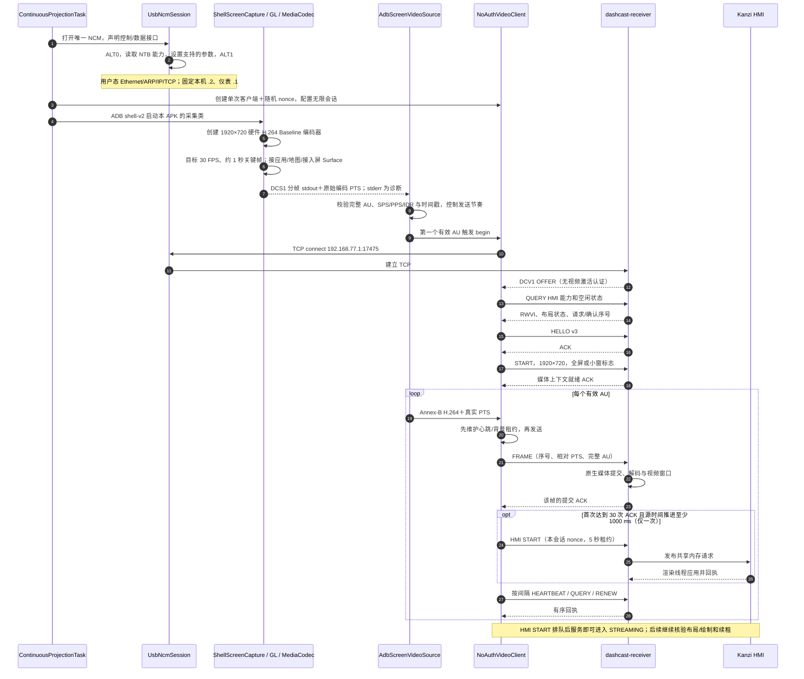

- 首个编码帧出现后才建立 TCP 视频会话；HMI 开洞在足够源进展之后。`START` 后 12 秒仍未达到源进展门槛会失败，避免把短暂空动画当成可用视频。
- 当前 `readyForStreaming()` 在投屏布局 START 已排队后即可返回真，并没有等待所有 HMI 绘制回读；后续循环继续确认。`STREAMING` 状态本身不等于布局/实车画面已经验收。
- H.264、背景控制和心跳由同一有序连接的所有者处理；一批 ADB stdout 含多帧时，逐帧发送前也维护租约，避免同步 ACK 等待把续租饿死。
- TCP 目的端口固定 `17475`（1.35.0 起；所有端口见 `DashcastPorts.kt`）；新连接的本地源端口可以变化。帧序号/线上的 PTS 按 v3 处理回绕，未设置两小时总时长限制。
- ACK 证明接收端报告的提交/状态，不证明解码帧数、屏幕动态画面或实际 30 FPS；编码目标帧率也不是实测帧率。

源码：[ContinuousProjectionTask](../android/app/src/main/java/com/byd/dashcast/phase1/ContinuousProjectionTask.kt)、[ShellScreenCapture](../android/app/src/main/java/com/byd/dashcast/phase1/ShellScreenCapture.kt)、[AdbScreenVideoSource](../android/app/src/main/java/com/byd/dashcast/phase1/AdbScreenVideoSource.kt)、[NoAuthVideoClient](../android/app/src/main/java/com/byd/dashcast/phase1/NoAuthVideoClient.kt)、[NoAuthVideoProtocol](../android/app/src/main/java/com/byd/dashcast/phase1/NoAuthVideoProtocol.kt)、[UsbNcmSession](../android/app/src/main/java/com/byd/dashcast/phase1/UsbNcmSession.kt)、[接收端](../instrument/native/dashcast_receiver.c)。

## 11. 仪表合成与租约

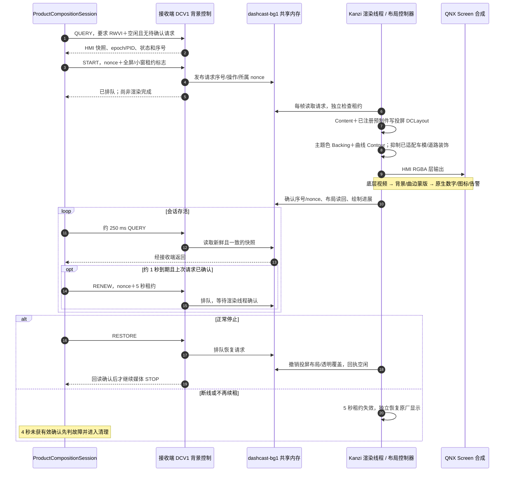

请求使用 DCV1 背景控制扩展（操作号 10）：QUERY/START/RESTORE/RENEW 分别为 0/1/2/3。START 线值 `5001` 是小窗选择哨兵，不能解释成实际比全屏多 1 ms 的租约；两档健康租约均按 5 秒维护。激活/待确认请求有约 1.5 秒边界；绘制计数用于证明原生遍历进展。

深浅模式通过原厂主题色参与背景合成。当前全屏采用 B2 配套遮罩/混合实现，不能把早期建议的“只改窗口预乘声明”当成现行方案。RWVG 小窗改为整屏接收后沿用直通 Alpha 模型，是当前实现的假设，尚缺该版实车 Alpha 读回证据。

1.25.1 在自有蒙版检查后增加全屏四个实际局部变换及速度对齐的读回；APK 给合法短暂待确认最多 1000 ms，不续租掩盖几何错误。原厂/小窗的几何动画不按全屏固定值校验。它仍不是所有元素或物理显示验收，见图 15。

源码：[ProductCompositionSession](../android/app/src/main/java/com/byd/dashcast/phase1/ProductCompositionSession.kt)、[product-runtime.thumb](../instrument/native-hmi/product-runtime.thumb)、[当前布局构建](../analysis/product_scene_layout.py)、[淡入配套构建](../analysis/fade_in_viewport.py)。

## 12. 全屏与小窗的分辨率和双端输出

| 层次 | 全屏 | 小窗 |
|---|---|---|
| 普通应用虚拟屏/超采样源 | 3824×996，320 dpi | 3366×1458，480 dpi |
| 原生地图/按名接入的源画布 | 1912×498，160 dpi | 1870×810，160 dpi |
| 1920×720 编码帧内的源画面载体 | `(x=4,y=89,w=1912,h=498)` | `(399,101,1122,486)`，源画布缩放 0.6 |
| 仪表视频窗口 | 1920×720，1:1 | 1920×720，1:1 |
| 最终清晰区 | 曲线遮罩透明区域 | 小窗遮罩透明区域 |
| 主屏操作窗口 | 保持源宽高比，按可用页面尺寸等比显示 | 保持源宽高比，按可用页面尺寸等比显示 |

上述源画布**包含外围淡入带**。清晰区是蒙版定义的曲线，不是把整块 1920×720 或表中的载体矩形都算作清晰区；源画布与清晰区不能混为一个分辨率。全屏和小窗也不是把同一块 1920×720 应用界面任意裁成两种窗口。

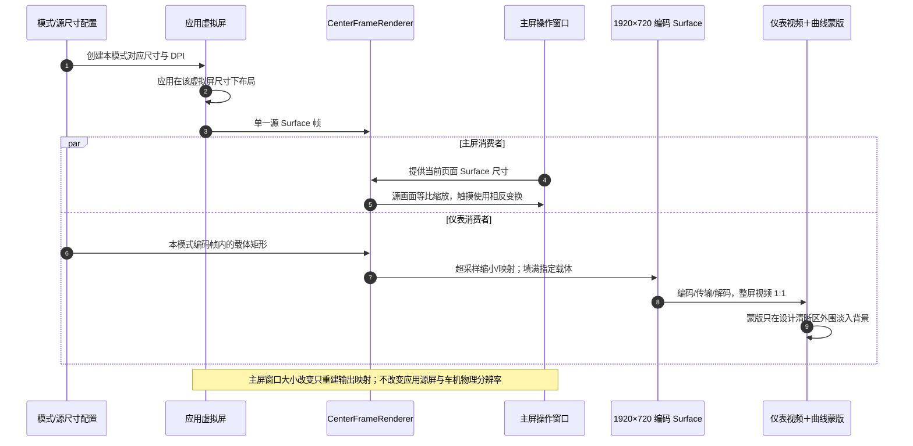

同一普通应用任务只执行一份源布局，两端输出尺寸可以不同，不能同时承诺该任务在两端各做一份独立自适应布局。主屏宽高比不同的剩余空间不应靠拉伸消除。定制地图有独立仪表界面时，才属于另一个原生页面。当前两档配置和淡入带是代码事实，不是对每个第三方应用在异形清晰区内完整可见的保证。

源码：[WorkspaceDisplayProfile](../android/app/src/main/java/com/byd/dashcast/phase1/WorkspaceDisplayProfile.kt)、[ProjectionDisplayProfile](../android/app/src/main/java/com/byd/dashcast/phase1/ProjectionDisplayProfile.kt)、[ContentViewport](../android/app/src/main/java/com/byd/dashcast/phase1/ContentViewport.kt)、[CenterFrameRenderer](../android/app/src/main/java/com/byd/dashcast/phase1/CenterFrameRenderer.kt)、[fade_in_masks.py](../analysis/fade_in_masks.py)。

## 13. 正常停止与更换应用

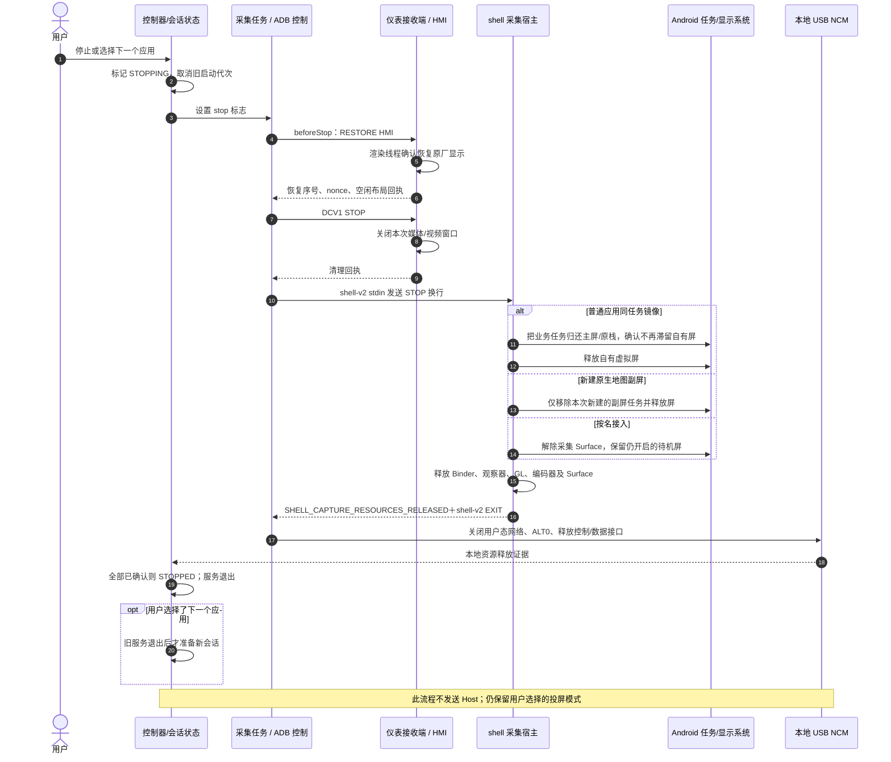

这里的顺序是实际 `AdbShellClient.ShellControl` 的 `beforeStop` → `STOP\n`。不能在宿主还未归还任务时先粗暴杀掉业务应用；也不能仅凭 TCP 关闭或 ADB 通道断开就记作清理成功。

正常清理至少区分：①采集宿主资源标记和真实 EXIT；②仪表背景/媒体清理；③本地 USB 资源；④是否存在打开一半而状态不明的资源。过程出错但这些全部已释放，可进入 FAILED；缺少确认则进入相应恢复状态。

源码：[AdbShellClient](../android/app/src/main/java/com/byd/dashcast/phase1/AdbShellClient.kt)、[ContinuousProjectionTask](../android/app/src/main/java/com/byd/dashcast/phase1/ContinuousProjectionTask.kt)、[NoAuthVideoClient](../android/app/src/main/java/com/byd/dashcast/phase1/NoAuthVideoClient.kt)、[CleanupRecoveryPolicy](../android/app/src/main/java/com/byd/dashcast/phase1/CleanupRecoveryPolicy.kt)、[ProjectionSessionController](../android/app/src/main/java/com/byd/dashcast/phase1/ProjectionSessionController.kt)。

## 14. 拔线、失败与自动清理

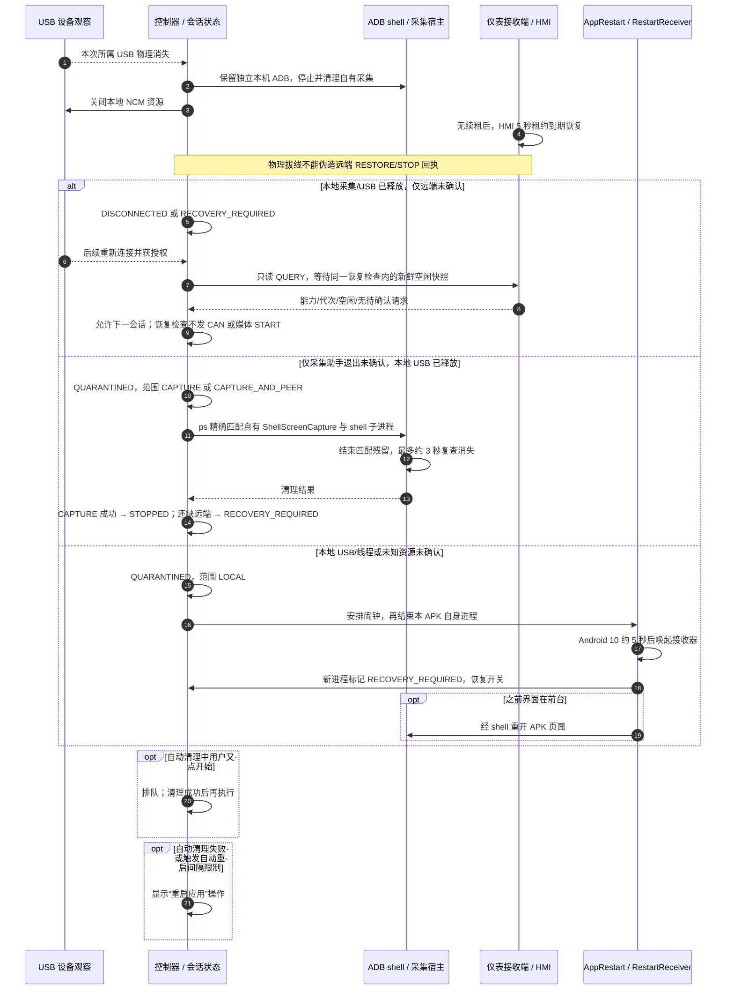

1.24.0 的自动结束目标是我方采集助手及匹配的 shell 子进程，不是被投业务应用；自重启最多每两分钟自动执行一次。若清理后仍缺仪表确认，必须继续空闲回读，不能直接当成恢复完成。

当前会话状态包括 `IDLE / STARTING / STREAMING / STOPPING / STOPPED / FAILED / DISCONNECTED / RECOVERY_REQUIRED / QUARANTINED`。“用户选择的 USB 模式”“是否枚举/授权”“媒体会话状态”是三个独立维度，不应压成一个开关真假值。

源码：[DetachedPeerRecovery](../android/app/src/main/java/com/byd/dashcast/phase1/DetachedPeerRecovery.kt)、[LeftoverCapture](../android/app/src/main/java/com/byd/dashcast/phase1/LeftoverCapture.kt)、[AppRestart](../android/app/src/main/java/com/byd/dashcast/phase1/AppRestart.kt)、[ProjectionSessionController](../android/app/src/main/java/com/byd/dashcast/phase1/ProjectionSessionController.kt)、[ProductController](../android/app/src/main/java/com/byd/dashcast/phase1/ProductController.kt)。

## 15. 整套仪表样式切换：几何控制

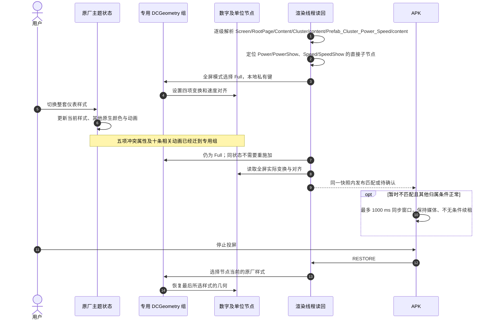

冲突的五项属性和十条主题转场规则集中到一个组；原厂主题组的其余规则、后续组及绑定保留。全屏固定几何；小窗/空闲使用当前原厂样式，并保留其原有几何动画。不存在先恢复旧样式快照的步骤。

实际 Thumb 与受控属性引擎替身的 92 个用例（包含原生直接子节点查找、实际 TOC 层级及1.25.0失败重现）覆盖字段错误、无效节点、同状态跳过、主题变化及最新样式恢复。尚未运行完整 Kanzi 或实车，本版效果仍待车辆确认。[构建模块](../analysis/theme_geometry.py)、[原生检查函数](../instrument/native-hmi/theme-geometry.thumb)。

## 证据范围

本文是按现行源代码、固定构建链和成品核对得到的实现文档，不是一次新的实车验收报告。基础 USB 切换、视频和部分接入已有历史实车证据；1.21.0 的自动 USB 授权/无障碍与按名接入也有实车日志。1.22.0 起的淡入/小窗 Alpha、1.24.0 真实采集助手的故障恢复等新增点仍应按各自的验证范围判断。

特别要区分：原生属性回执、提交计数、绘制遍历、模拟器行为，与目标仪表真实硬解、Screen 合成、动态画面及安全信息可见性。整套样式切换修复已实现并通过离线检查，实车验收保持待确认。其他边界见[验证状态](VALIDATION.md)、[架构](ARCHITECTURE.md)和[使用说明](USAGE.md)。

## 16. 投屏告警位置覆盖（1.26.1）

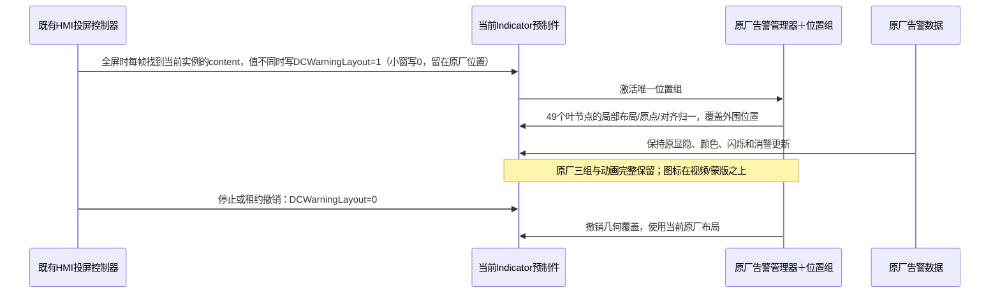

全屏、小窗位置相同。状态机读控制值时不向父节点查找，所以必须写在content本地；换整套样式后下一帧给新实例写值。写入不参与投屏布局确认，也没有新增协议或APK开关。资源、原生矩阵和属性替身检查不等于完整Kanzi或实车通过。
