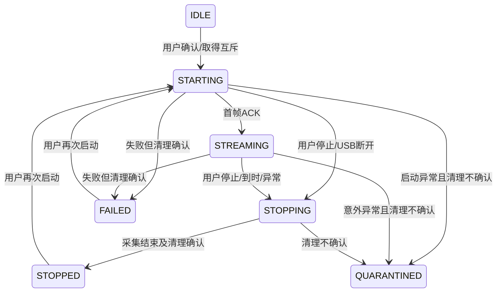
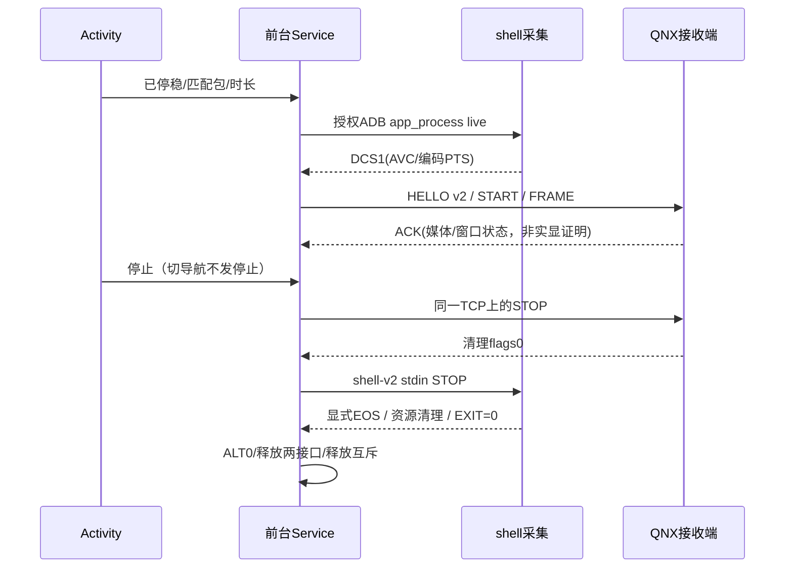

# 0.5.0：持续小窗投屏任务与验收

基线：0.4.4，承接 PHASE1_WORKLOG 的 B-01～B-09；旧 P 项不因本次新功能重新打开。用户授权按任务实施并维护公开仓库 `code-new-bie/byd-dashcast` 的 `2021-song-plus-dmi` 分支。

本次里程碑只做持续小窗，不同时扩分辨率、全屏、导航裁剪、Kotlin 重写或带线强制切 Host。参考包2 OS 与国内原版 MCU 内容不改；保留 640×240 Baseline、正常 ADB/USB 授权、原厂导航中继、NCM 协商与退出、TCP 31707。交付仍只有仪表 ZIP + APK；完整 ZIP 携带的 MCU 必须是原件，不等于升级器不刷写。

| 任务 | 依赖 | 实现和完成标准 | 状态 |
|---|---|---|---|
| T1 长会话契约 | 无 | 新 DCV1 HELLO version=2 与旧 version=1 并存；长模式在老仪表上必须 START 前失败；最长30分钟/65000帧/每帧2MiB，仪表31分钟总时限及15秒心跳保护 | 开发/离线通过 |
| T2 受控采集 | T1 | 保留原短时 AnnexB 探针；长模式用有界 DCS1 帧封装真实编码 PTS及显式EOS；shell-v2固定stdin STOP，EXIT=0确认采集结束；ADB数据进展续期，无进展/停止排空仍限时 | 开发/离线通过 |
| T3 前台会话 | T1/T2 | Service 拥有 NCM/视频/采集，Activity 不拥有长会话；切导航/重建界面不取消；通知提供停止；进程内互斥、拒绝重复启动/角色重叠、内存日志有界且导出可回收 | 开发/状态机单测通过，ROM实测待执行 |
| T4 退出与异常 | T3 | 正常停止/到时/USB断线各自有界清理；STOP不确认或USB退出失败不得伪报成功/自动重试；保留仪表guard，不强杀共享服务；模式恢复仍停视频、确认清理、拔线再切Host | 开发/契约回归通过，实车待执行 |
| T5 验证/配套包 | T1～T4 | JVM、真实ARM指令离线、脚本及原NCM驱动契约回归，原App46成员和OS/MCU哈希审计，同签名APK和新仪表App；10/30分钟真车验收另列为待用户执行 | 开发/离线/成品独立审计通过；实车待执行 |
| T6 GitHub维护 | T5 | 精确同步审核源码/新测试/任务及使用文档，更新公开来源清单，WSL git/gh正常提交推送指定分支并回读CI；不公开私钥、原始实车日志或工作区缓存 | 源码/文档同步及本地复测完成；提交/CI以本次Git检查为准 |

真车验收：停稳或台架先10分钟再30分钟；观察动态画面和关键仪表信息，切导航后继续，停止后窗口退出，连续启动三次，再拔线恢复Host并识别普通U盘；另做无视频Host/NCM循环、重复NCM按钮回归。离线测试、窗口属性或TCP ACK均不能替代这些观察。异常断线若清理不确认，停止测试并正常重启，不删guard或连发命令。

停止审查修正：保留仪表原1.5秒视频空闲保护，不能等Android显示/编码器完全拆除后才发送视频STOP。用户停止时先由同一线程结束QNX视频，再发所属采集stdin STOP；自然结束在DCS1显式EOS（shell资源清理之前）结束QNX视频。两边清理全部确认后才释放NCM和进程互斥。停止stdin的10秒排空预算从发出采集STOP后计时，不被QNX媒体清理预算占用。第一轮未加此保护的候选包已移入内部结果目录保留，不交付。

后续：安全显示区域经实车确认后再实现 fit/crop/导航区域与更高清；自动连接和简化UI在持续运行及异常恢复验收后实施。技术参考：[Android前台服务](https://developer.android.com/develop/background-work/services/fgs/launch)、[Android10隐私变化](https://developer.android.com/about/versions/10/privacy/changes)，以目标ROM API29及现有OEM接口证据为准。

本文件的“完成”仅指对应开发/离线验证步骤完成；实车10/30分钟结果尚不存在，不声明产品稳定性已验收。

## 开发与离线结果

2026-10-13：工作区259 JVM/37套、公开副本227 JVM/34套均构建及lint通过（分别0错误6/5警告）；28真实ARM指令离线、35脚本/4语法、5原NCM驱动契约、30帧桌面MD5、最终OEM接口/入口及成品独立审计通过。新增EOS/STOP顺序、只给长采集续期ADB、保留短探针/诊断绝对超时的反例测试；不是在车上连续运行30分钟。

仪表相对0.4.4仅receiver四槽122字节改变；USB/四脚本、原App46成员/元数据与Boot镜像保留。参考OS与国内MCU逐字节不改；实际打包Service非导出、stopWithTask=false、connectedDevice及原APK签名核对。公开副本App离线重建与bf8446491f0277a66e25fbb96a6355b403735ae5ad8dfbe079cd34958a2b5641相同。

发布边界：维护0.5.0源码和本地首测包；旧0.4.4 Release不替换。新用户应选择匹配两端及恢复方案，不能以0.5.0开发源码和旧0.4.4接收端验证长会话。停止和时长结束都等待两端清理结果，不自动切Host；首次600秒通过再1800秒。布局/分辨率和自动连接仍是后续任务。
